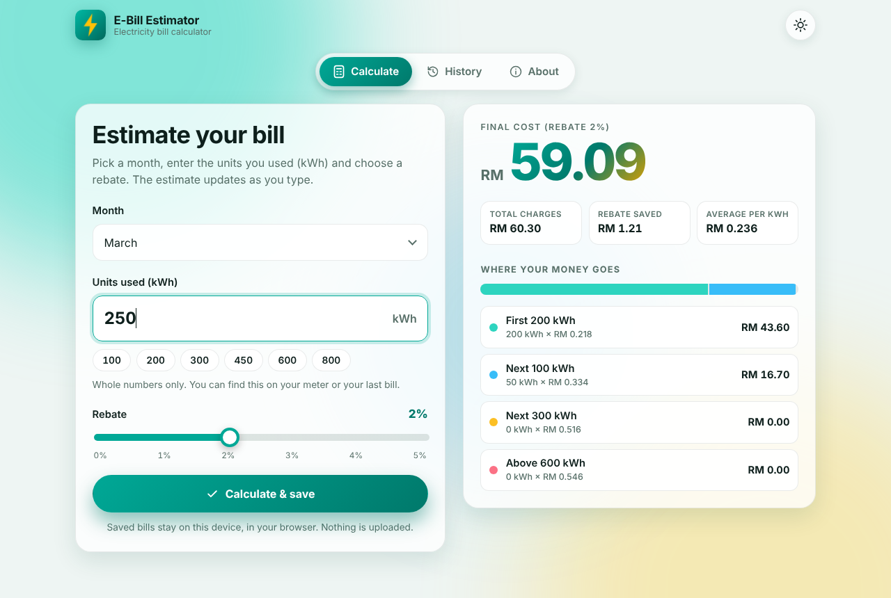
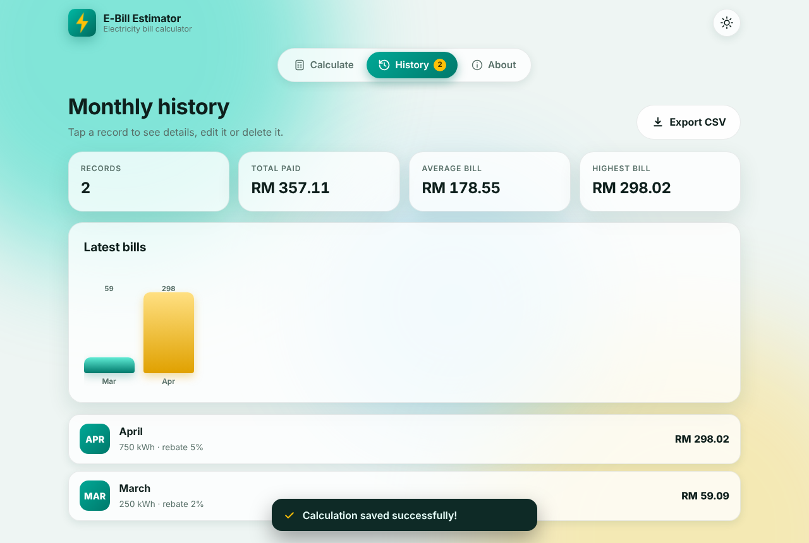
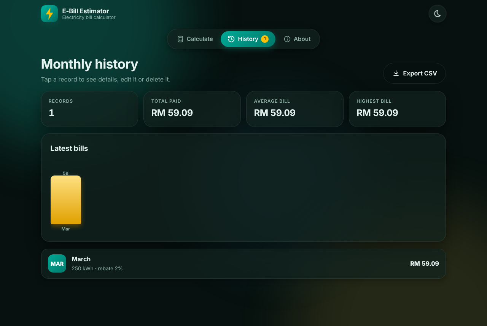
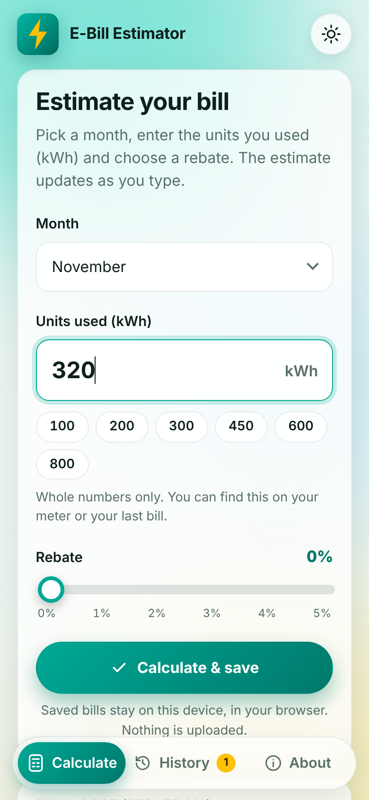

# ⚡ E-Bill Estimator

Estimate your monthly electricity bill from the units (kWh) you used, apply a rebate, and keep a history of past bills.
The tariff is a four-block domestic rate, calculated the same way in the **Android app** and in the **web version**.

| | |
|---|---|
| 🌐 **Web app (laptop / phone browser)** | https://yutfi.github.io/Electric_Bill_Estimator_Lutfi/ |
| 📱 **Android APK** | [Latest release → `E-Bill-Estimator.apk`](https://github.com/YutFi/Electric_Bill_Estimator_Lutfi/releases/latest) |

> The web link works once GitHub Pages is switched on for this repository (Settings → Pages → Source: **GitHub Actions**). See [Deployment](#deployment).



## Features

- **Live calculation** – the bill updates as you type, with animated count-up numbers and a per-block breakdown bar.
- **Rebate** – 0–5 % rebate applied to the total.
- **Bill history** – save a bill for a month, then view, edit or delete it. Totals and averages shown on the History screen.
- **Validation** – rejects empty, negative, decimal and unrealistic values with clear messages.
- **Modern UI** – Material 3 (Android) / responsive layout (web), light & dark theme, smooth animations that respect “reduce motion”.
- **Web extras** – installable as a PWA, works offline after first load, CSV export of history.

| History | Dark mode | Mobile |
|---|---|---|
|  |  |  |

## Tariff

| Block | kWh | RM / kWh |
|---|---|---|
| 1 | first 200 | 0.218 |
| 2 | next 100 | 0.334 |
| 3 | next 300 | 0.516 |
| 4 | above 600 | 0.546 |

`final = total − total × rebate% / 100`. These rates are the ones used by the original app; check them against your own utility's current tariff before relying on the figure — this is an estimate, not an official bill.

## Project structure

```
app/                     Android app (Java, Material 3, SQLite)
  src/main/java/…        MainActivity, BillCalculator, BillDatabaseHelper, list/detail/edit/about screens
  src/test/java/…        JUnit tests for the calculator
docs/                    Web version (plain HTML/CSS/JS – no build step, no dependencies)
  js/tariff.js           Same maths as BillCalculator.java
  js/app.js              UI, history (localStorage), animations
tests/tariff.test.js     Node test for the web maths
.github/workflows/
  pages.yml              Tests + deploys /docs to GitHub Pages
  android-apk.yml        Runs unit tests, builds the APK, publishes it on tagged releases
```

## Run it

**Web** – open `docs/index.html` in a browser, or serve the folder: `cd docs && python3 -m http.server 8000`.

**Android** – open the project in Android Studio and run, or `./gradlew assembleDebug`. Requires JDK 17 and the Android SDK.

**Tests** – `node tests/tariff.test.js` and `./gradlew testDebugUnitTest`.

## Install the Android app

1. Open the [latest release](https://github.com/YutFi/Electric_Bill_Estimator_Lutfi/releases/latest) on your phone and download `E-Bill-Estimator.apk`.
2. Allow “install unknown apps” for your browser when asked, then open the file.
3. If you have an **older version installed from the previous APK, uninstall it first** — this release is signed with a different key, so Android won't update over it (the old history stays in the old app only).

The APK is signed with a fixed, public sideload key stored in the repo so that every release has the same signature. That is fine for sideloading, but it is **not** a Play Store signing key.

## Deployment

- **Web:** every push to `main` that changes `docs/` runs `pages.yml`, which runs the Node test and publishes the site. One-time setup: *Settings → Pages → Build and deployment → Source: GitHub Actions*.
- **APK:** every push builds and uploads the APK as a workflow artifact. To publish a downloadable release run `git tag v2.0 && git push origin v2.0`.

## Testing

- The web tariff was compared against the original Java `BillCalculator` on 12,024 inputs with identical results.
- The web app was exercised in headless Chrome (validation, save / edit / delete, persistence, theme, navigation, mobile layout, no console errors).
- The Android project compiles and its JUnit tests pass in GitHub Actions. The app has **not** been run on a physical device or emulator by the author of this update — please report anything that looks off.

## Ideas for later

Per-month charts, appliance-level estimates, tariff presets for other countries, cloud backup of history.

## Author

Ariff Lutfi Bin Shahrim (UiTM). MIT-style, free to learn from.
